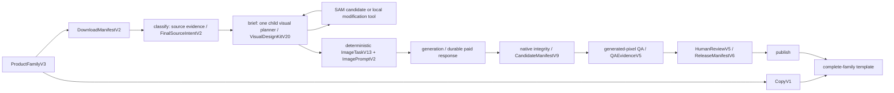

# Architecture

`core/production.py` is the only production controller. Full runs, resume and
`--stages` use the same handlers:



## Responsibilities

- ProductFamily and category contracts own catalog facts. Source observations
  supply visible evidence, not permission to redefine product specifications.
- `classify` observes the selected gallery once and retains usable rows. Role
  hints, main selection and size evidence feed the fixed output inventory. OCR
  is a supplement for necessary text gaps, not the primary role classifier.
  Full-product appearance can be supported by bound visible product membership
  even when no independent functional feature was observed.
- `brief` owns one visual plan per selected child. The planner chooses target
  state/actions, exact evidence-bound copy, observed measurement IDs and region
  intent. Its explicit `evidence_assessment` records support or unresolved facts.
  It is a model decision, not a claim that image quality has been verified.
- There is no independent claim/depiction reviewer, inherited source-point verdict
  cache, shared-design judge or automatic brief-to-observation correction loop.
  Program code does not infer image-copy count scope from natural-language regex.
- SAM returns geometry proposals. The planner, not anchor-hit heuristics, decides
  whether that geometry fits its plan. Generated-image QA later checks new pixels;
  it does not simply endorse the plan or repair images automatically.

## Planner tool continuation

The existing brief controller prepares SAM, then sends only affected roles and
relevant source/region evidence to the planning route. Shared design is read-only
context, serialized once. No full history of earlier judgments is sent.

One shared contract describes `create_draft`, `repair_contract`, `decide_region`
and `confirm_region` work. Each request includes its schemas, permitted field IDs,
actual source/owner/candidate IDs and frozen slot purpose; it assumes no chat memory.
Responses use `supply_plan`, `patch_plan`, `accept`, `change_region` or an evidence-bound
`blocked`. Patches are atomic, whitelist-limited and fully validated before admission.
An independent field patch may explicitly accept the same inspected region in that
transaction. Changed source, owner, geometry, required visibility or mask still needs
new-content confirmation. An invalid proposal is not an executed region modification.
The current work wire is `planning-work-v3`; Kit V20 and accepted content identities
stay unchanged. `capabilities` separates proposing a change, locally executing it,
and remaining confirmation requests. The last paid request may still produce a
useful authorized local modification; its result waits for confirmation without an
automatic additional request. `can_modify` no longer conflates those permissions.

Valid roles settle independently. Missing/malformed roles become protocol issues,
not fabricated model refusals. Only unfinished roles use the remaining grant; two
identical no-progress failures stop that work. Source, resource, contract, semantic,
protocol and allowance failures have different recovery conditions. Four physical
tool requests per child grant and five roles per batch remain the defaults, not a
success guarantee. A prompt/content revision never grants another four requests.

Request slots are reserved before dispatch. Positively known unsent calls release
only their reservation, not consumed budget. Lost/interrupted physical calls remain
counted. Transient outages may resume within the same allowance. Saved tool responses
and pending local actions recover without another model request or duplicate SAM
operation. Raw responses, frozen request contexts, prompt bytes and resulting
content are bound by SHA/identities; there is no recursive judgment inheritance.
The journal now lives at `visual_design_kit_traces/<child>/attempt_budget.json`,
independent of prompt/content revisions. It reconciles carried consumption and
physical reservations. Receipts verify only the consumed raw role against its frozen
schema, not today's re-parsing of unrelated failed siblings. Content identity tracks
actual source/mask/fact/design dependencies; request identity and grant identity are
separate. Changed role dependencies do not revoke unchanged sibling execution.
A validated action is persisted before atomic local admission. Execution operates on
a copy and commits the new draft only after its bound result is durable. `phase`
retains the actual work stage, `issue` retains the root cause, and `pause` identifies
missing authorization, budget or resource capacity. A grant does not erase the
same-input no-progress record. Saved actions are recovered before new model work.
Adopting a formerly unexecutable saved proposal requires explicit operator permission;
it cannot replace an accepted role, reset its local limit, or invent an accept.

Source usability is shared across observation, attachments and planning. Unresolved
sources and unallocated requirements remain visible; existing slots are never silently
renumbered, reanchored or dropped. SAM preparation uses its own necessary dependencies,
not unrelated typography/copy validity. Worker events expose interpreter/launcher PIDs,
imports, weight loading, GPU transfer and inference. Computation AST/weights/packages,
not startup-log wording, bind new SAM computations; accepted immutable masks stay bound.
One owner may have several required views. Candidate catalogs remain available when
a region proposal is allowed; owned multi-selection reuses saved masks without SAM.
Highest score is only an initial proposal, never proof that all views are covered.
Semantic segmentation uses crop/query; diagnostic anchors do not drive that mode.
Interactive signed deltas use point prompts. Do not infer improvement from moving
only diagnostic points, or automatically union every candidate.

## Source and design input bindings

ProductFamilyV3's current extraction policy is `product-family-v3-resolved-facts-v14-bound-identity-offer`.
Returned ASIN, requested marketplace/category/extractor contract and raw byte hashes are bound.
Confirmed size decisions and owned price/currency enter the same effective facts projection;
conflicts never fall back to a nonempty sibling/spec value. Brand/SKU-only metadata changes
are locally reprojected by fetch, not purchased again. Missing first family is resumable;
malformed/retired source contracts are not silently refreshed or migrated.

Current VisualDesignKitV20 policy is `single-planner-bound-design-input-v2`. Effective brand
and consumed category design inputs bind the sealed planner evidence and downstream task.
A real input change requires a new shared plan in the existing journal allowance, not a
re-seal of old art. Previous roles/actions are retained as journal history; spending, grants,
physical-operation limits and candidate files are not reset. New image task policy is
`output-evidence-child-direction-v57-bound-design-selection`; main confirmed sold quantity
and typed source selection are carried to the existing independent QA observer.

Fetch/copy/OCR use `service_response` only as durable single-request storage. Their existing
stage owners retain transport, polling and semantic decisions; no second scheduler is added.
Unknown POST cannot be retried implicitly or escaped by changing its input key for the same
logical owner. Existing run IDs recover via GET; explicit receipt resolutions send no request.

## Deterministic boundaries retained

- Complete frozen child/source/output inventory and independent successful siblings.
- Current source, fact, prompt, candidate and approval identity; job-owned paths.
- Bounded geometry, correct original source/mask dimensions and declared ownership.
- Valid evidence/reference IDs, approved design-transfer scope, confirmed sold-unit
  ceilings and observed measurement selection. Model-written facts do not override
  the catalog. Unknown evidence stays unresolved.
- Separate exact-copy and measurement authorities. Title/body styling is omitted
  when those strings are not authorized. Main/scene may omit display_copy or supply
  exactly `{title:null, labels:[]}`; an explicit empty declaration survives compilation
  because it is part of the accepted plan identity. Never strip it after acceptance.
  Nonempty/malformed main/scene copy is rejected, not silently discarded.
- Nonempty support for every declared protected instance before accepting a mask.
  P/N hits and small boundary misses are diagnostics, not material/completeness proof.
- One primary edit photograph; auxiliary images verify facts, not new geometry.
  Function and size roles do not fall back to new-product rendering or local final
  image composition. No source-pixel paste-back fallback was added.
- Native results are non-solid, square, 1024..4096 pixels; output <=32 MiB,
  response envelope <=48 MiB and pixels <=16,777,216. Source and opaque region map stay aligned through input resizing; the map is appended as an ordinary image, not a dedicated mask parameter. Candidate provenance binds that extra attachment without rewriting historical receipts.
- Undersized native images use official RealESRNet x4plus, with explicit NCNN GPU index/name,
  bounded tiles/threads/timeout and the same exclusive host GPU resource as SAM.
  Already-sized bytes and downsampling do not need neural enlargement. Execution or
  configuration errors fail explicitly; they never silently select Lanczos.
- `revise --mode publication_reprocess --upscale-artifact-confirmed` is the only
  publication Lanczos enlargement path: the operator confirms an observed upscale
  artifact on the selected candidate, supplies its exact SHA and describes the issue.
  No automatic artifact detector or second QA authority was added. It derives from a
  selected candidate's finalized, SHA-bound native response. It uses the same
  staging/manifest/publish authority, reserves a role-local operation/revision, and
  sends no request. CandidateManifestV9 has an optional strict `publication_reprocess`
  lineage record; native model mode, prompt, references and request audit stay intact.
  This is not a new remote request or approval. Other current candidates stay valid,
  and changed output bytes need their own QA/review.
- Rejected/unknown paid image responses retain their receipts. Automatic unknown
  replacements remain disabled by default; explicit operator grants permit one
  replacement within the existing three-replacement chain ceiling.
- Transport cooldown is separate from receipt authorization: two failures cause a
  180-second shared-domain cooldown, with one expiring cross-process half-open probe.
- QA remains the sole hard-fact authority. Release projects required listing readiness
  separately from completion of all frozen outputs; unused failed references are diagnostics,
  not an extra listing veto. Explicit factual failures cannot be overridden. White edges do not prove a white
  external background. A mask submission does not establish provider compliance.

## Canonical artifacts

```text
job_state.json                           (JobStateV8)
source/product_family_v3.json
reports/run_scope_v5.json
reports/copy_v1.json
images/download_manifest_v2.json
reports/final_source_intents_v2.jsonl
reports/visual_design_kits_v20.jsonl      (VisualDesignKitV20)
reports/image_tasks_v13.jsonl
reports/image_prompts_v2.jsonl
reports/candidate_manifests/<child>/<role>/<task_fingerprint>/candidate<N>.json
reports/qa_evidence_v5.jsonl
reports/human_review_v5.json
reports/release_manifest_v6.json
reports/production_summary_v3.json
images/_r2_image_urls.csv
```

Retired planning and CandidateManifestV8 execution paths are refused; no compatibility
reader or automatic historical migration exists. Current preparations belong to their
original owner. Normal execution can resume the same image-contract projection; verified
before-images permit safe cancellation when its inputs drift. Unrelated writes remain
protected. Candidate bytes, paid receipts and consumed allowances are not reset.
Job protocol remains 6.0 and JobState remains 8.

New batch/CLI execution explicitly selects progressive or strict admission. The former
checks remote prerequisites at consumption, after local reuse; the latter retains immediate
full-delivery preflight. RunScope retains failed known target members. Child-local planning
journal identity does not change when an independent sibling arrives or the original order
is promoted to its full target. No new order or budget is created by promotion.

QA semantic identity excludes connection credentials. The batch binds effective execution
semantics; credential rotation and layout/CSS-only changes do not alone change
that execution revision. Inline scripts, JavaScript and form-control contracts remain bound. Receipt/local-arrival wake hints are not authorization or cache
validity: the existing owner must validate the actual bytes before consuming them.

Publisher-managed versions use before/new hashes, private backups and no-clobber installation.
Delivery-package-v3 streams binary members and bounds structured serialization; it includes
required/actually selected URLs, allows local optional assets, and retains raw HTTP privately.
See [the current operations guide](unattended_batches.md) for implemented behavior and known
remaining work. No true-image, Amazon acceptance or unattended-duration claim follows from
these architecture rules.

## Execution selection and outcomes

`--generation-tasks` is a generate-only debug permission, never a smaller output
inventory or planning workaround. It validates before state changes. `None` means
omitted; explicit empty lists fail. Selected dry-run validates actual tasks/prompts
without candidate/receipt recovery. Returning from accepted selected execution to
all-current-scope execution requires `--all-generation-tasks`. Ordinary jobs need
no extra flag. Invocation results and whole-job completion remain separate.

A candidate is not QA approval; QA approval is not human approval; published partial
images are not a complete family template. Human review owns aesthetic judgment.
A changed candidate invalidates its old approval. Final template readiness requires
all required children/roles, accessible URLs, current copy and audited fields.
This project does not claim Amazon acceptance without an active SP-API submission.

Exit codes: 0 completed; 1 failed/pending; 2 lock conflict; 3 awaiting review;
4 useful partial completion. Inspect the separate execution, workflow, QA, release
and template fields instead of inferring image quality from a command exit code.
