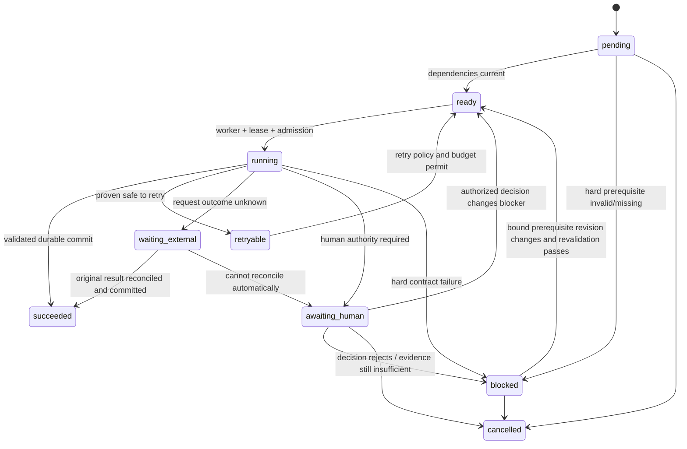

# Production Readiness 1.0 — State Transition Specification

**Baseline:** `a74dc61542360ca1ae8ccb30194380d2921cafc9`.  
**Status:** target semantics. Existing enums and artifact schemas must be reconciled before changing schemas; do not add a parallel state store.

## 1. State authority

| Concern | Authoritative owner | Non-authoritative projections |
|---|---|---|
| Order enrollment, lease, spending, admission, retry scheduling | BatchLedger | Console and batch summary |
| Stage/task execution attempt and current runtime state | Job State (`job_state.json`) | Production summary/progress trace |
| Catalog facts and family membership | ProductFamilyV3 + source evidence/resolutions | Copy, image, template projections |
| Frozen target inventory | RunScopeV5 | Progress counters |
| Planning requests, grants, decisions and local actions | Existing child Planning Journal | Visual plan status |
| Image task/prompt contracts | ImageTaskV13 / ImagePromptV2 | Brief diagnostics |
| Candidate identity and bytes | CandidateManifestV9 + native receipt | Candidate inventory |
| QA factual result | QAEvidenceV5 | Release row |
| Human decision | HumanReviewV5 | Console decision status |
| Publish eligibility | ReleaseManifestV6 plus current URL receipt | Published-image plan |
| Template plan/workbook | Template plan + workbook hashes | Template status |
| Final delivery | Immutable delivery commit/current pointer | Batch delivered projection |

No downstream projection may silently promote an upstream artifact to a stronger state.

## 2. Task state vocabulary

The target semantic vocabulary is:

- `pending`: task exists but a dependency or dispatch decision has not yet made it runnable.
- `ready`: all declared hard dependencies are current; safe to dispatch.
- `running`: an active, fenced worker owns the attempt.
- `succeeded`: output is committed, validated and bound to the current input revision.
- `retryable`: owner proves retry is safe under its request/side-effect contract.
- `waiting_external`: request may have been sent; result/remote side effect is not yet known. No duplicate submission.
- `awaiting_human`: a specific decision from an authorized human is required.
- `blocked`: hard prerequisite is missing, contradictory or invalid; no dispatch until prerequisite changes.
- `cancelled`: explicitly cancelled by an authorized decision; terminal for that task revision.

These are semantic states, not a mandate to expand the existing Job State enum immediately. Current Job State uses `pending/running/retryable/blocked/review/success`; current batch ledger has separate order states. Phase 1 must map semantics onto existing schema first and justify any schema change with migration/recovery proof.

## 3. Allowed transitions

Forbidden transitions:
- `waiting_external -> ready` solely because a timeout elapsed;
- `waiting_external -> retryable` without owner proof that original request was not sent or provider idempotency/reconciliation contract;
- `awaiting_human -> succeeded` merely because a review file exists;
- `running -> succeeded` before output hash/provenance commit;
- `blocked -> ready` without revalidating the changed dependency;
- a stale lease/worker may not update any current task, reservation or completion hold.

## 4. Request lifecycle

For each externally side-effecting request, retain the existing owner and its durable receipt. Required semantic lifecycle:

`prepared → reserved → submitted → received | unknown → validated → committed`

- `prepared`: immutable request bytes and logical owner identity persisted.
- `reserved`: current lease, order policy and service budget authorize one physical call.
- `submitted`: transport owner has evidence the request was sent.
- `received`: original response/native bytes durably saved and hash-bound.
- `unknown`: send may have occurred but outcome is not established.
- `validated`: response is bound to request and passes protocol/content checks.
- `committed`: owner artifact is atomically/transactionally finalized and current.

A transport timeout is not proof of unsent. A response file is not proof of semantic success. A local commit failure must recover from the saved response without repeating the remote request.

## 5. Completion projections

Never overload one boolean:
- stage selected-range completed;
- task/group/role succeeded;
- child required roles ready;
- required family release ready;
- listing-ready;
- all frozen output complete;
- delivery package committed/current;
- marketplace submission accepted (not currently part of this production chain).

The console and summary should expose blocker owner, reason code, input revision, waiting age, next action and whether human action is required.

## 6. Currentness and invalidation

Every successful state is valid only for its bound input revision. Revisions must reflect semantic dependencies, not unrelated timestamps, credentials, or whole-job hashes when those do not affect the task. A change to shared family facts may invalidate multiple consumers; a role-specific prompt/policy change should not invalidate sibling roles. Historical schemas and stale cache rows are not silently migrated into current authorities.

## 7. Schema change gate

Before adding states or fields:
1. inspect `schemas/job_state.schema.json`, `core/status.py`, `core/batch_ledger.py`, all readers/writers and recovery tests;
2. choose one authority and one serialization;
3. define crash points before/after each write;
4. prove idempotent recovery and stale-worker fencing;
5. update schema and current-path tests together;
6. delete superseded transitions/readers/tests in the same change.

No second database, event bus, DAG engine or shadow task-state JSON is authorized by this specification.
