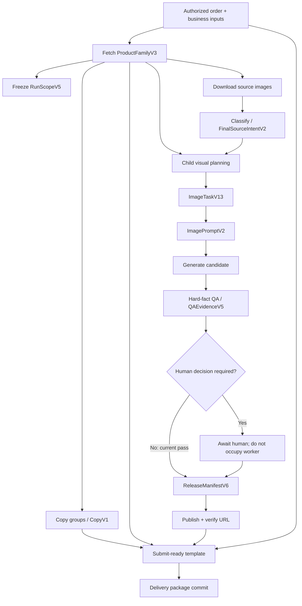

# Production Readiness 1.0 — Task Dependency Map

**Baseline:** `a74dc61542360ca1ae8ccb30194380d2921cafc9` on `codex/model-native-image-refactor`.  
**Purpose:** distinguish hard dependencies from operational ordering. This is a target contract to verify against each owner before implementation.

## 1. Dependency graph

The graph is not a command to execute every node serially. Independent ready nodes should advance concurrently within existing worker/service/budget limits. A stage CLI selection remains an explicit maintenance scope, not a promise to execute omitted downstream stages.

## 2. Hard dependencies by owner

| Work item | Required current inputs | Does not depend on | Smallest useful unit |
|---|---|---|---|
| Fetch | Authorized order identity, category/plugin, marketplace and fetch credentials | Copy, image provider, QA, template workbook | One family fetch / child fetch where owner supports it |
| RunScope | Verified family inventory and explicit target policy | Copy success, image success | One frozen family scope |
| Copy child group | Current ProductFamily facts and source copy permitted by fact policy; writer route/receipt | Image download, visual plan, image QA | One exact copy group |
| Parent copy | Current required child copy payloads and family relation | Published images | One parent row |
| Download | Source image URL, destination policy, network access | Copy, visual planning, QA | One source URL/child |
| Classify | Downloaded bytes and source identity | Copy, template workbook, image provider | One source observation/child |
| Visual plan | Current product facts, source observations and authorized planning allowance | Copy success, image generation | One child/shared plan, then scoped role work |
| ImageTask | Accepted plan, source role/reference, category contract | Copy, publish | One child/role task |
| Prompt compile | Current ImageTask and accepted plan | Other roles' prompt success | One task fingerprint |
| Generate | Current task + prompt + bound source/reference/mask + provider admission | Other candidates, copy, template | One image task/candidate attempt |
| QA | Candidate bytes + current same-child fact/reference bindings + QA policy/route | Other candidates' QA | One candidate |
| Human review | Exact candidate/evidence revision and reviewer authority | Other children/roles | One child/role/candidate decision |
| Release | Current QA and human decision authority | Unrelated failed siblings, except family-required completion projection | One child/role row |
| Publish | Approved current release row, object-store credentials and budget | Copy success, unapproved roles | One child/role object |
| Template draft/preview | Available current facts, business inputs, current copy fragments and available image bindings | Optional gallery completion | One child/row or family preview (capability to verify) |
| Submit-ready template | Complete required family, current required copy, required approved/published images, valid business fields, current workbook contract | Optional roles not required by category policy | One family workbook |
| Delivery | Current verified workbook, release/URL manifest and immutable asset set | Amazon platform acceptance | One immutable delivery revision |

## 3. Cross-branch rules

1. Copy failure must not stop source download, classification, planning, generation, QA or publication of independent image work.
2. Image failure must not invalidate current copy artifacts.
3. A child-level failure must not invalidate another child's successful artifacts.
4. A role-level failure must not invalidate sibling roles.
5. A planning revision invalidates only tasks whose declared dependencies changed. Shared plan changes may legitimately affect multiple roles; role-only changes must remain scoped.
6. A fact revision invalidates only consumers that bind that fact. Identity, family membership and variation changes may have wider impact and must be explicit.
7. A candidate revision creates a new candidate identity; it never overwrites an accepted candidate or its evidence.
8. QA uncertainty waits for human resolution; it is not an automatic pass and must not block unrelated ready candidates.
9. Publish retries reconcile the original object key/request and verify bytes before another PUT.
10. Template failure never triggers upstream regeneration. It blocks only the workbook/delivery task until its actual dependency changes.

## 4. Known family-level convergence points

Family-level gates are legitimate at:
- parent copy generation, which depends on the selected child-copy payloads;
- variation relationship and full-family completeness;
- submit-ready workbook generation;
- order-complete package projection.

These gates must not be pushed upstream to block independent asset creation. They must not be weakened for formal submission. Provide partial preview only if the existing template engine can do so without misrepresenting the family as submit-ready.

## 5. Ordering versus dependency

The canonical stages `fetch,copy,download,classify,brief,generate,qa,publish,template` remain useful for operator workflows and stage reports. Their order must not be treated as a universal hard dependency. The current progressive work-unit scheduler runs required child work before optional gallery work; this scheduling policy is distinct from dependency correctness and must preserve the full frozen target denominator.

## 6. Required verification

For every row above, implementation review must identify:
- the function that checks dependency currentness;
- the authoritative input artifact and revision;
- the task identity and result artifact;
- how a sibling failure is represented;
- what event or operator action makes it runnable again;
- whether a worker is held while waiting;
- the exact test that proves no unrelated work is invalidated.
